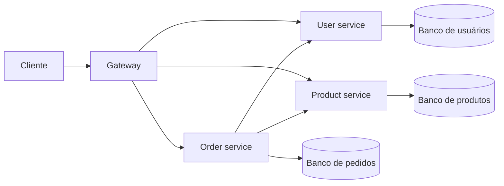
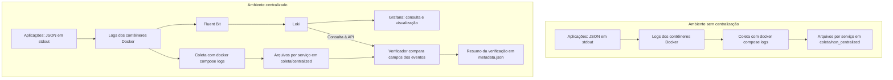

# Guia de escrita do TCC com os dados já coletados

Preparado em 21/10/2026 para Ricardo Viana Marinho.

Este roteiro usa o pré-projeto, o TCC indicado pelo orientador, as quatro referências do ZIP e os registros existentes em `coleta/`. Ele orienta a redação sem exigir alterações na aplicação, novas execuções ou novas medições. As formulações abaixo são propostas de redação; as interpretações dos resultados são retrospectivas e devem ser identificadas dessa maneira no trabalho.

## 1. O que foi examinado e como usar cada material

| Material | O que oferece para a escrita | Como será usado |
|---|---|---|
| `Downloads/TCC - Eduardo Paz Vieira.docx.pdf` | Exemplo de artigo de TCC da UFERSA, com o mesmo orientador | Organização das seções, apresentação de arquitetura, descrição do procedimento e ligação entre resultados e conclusão |
| `Downloads/PROJETO-TCC-RICARDO-VIANA-MARINHO_EXA1704.docx.pdf` | Tema, justificativa, questão de pesquisa e objetivo apresentados no pré-projeto | Continuidade do problema de pesquisa e delimitação do estudo realizado; o arquivo, isoladamente, não comprova aprovação administrativa |
| `Downloads/drive-download-20261021T041553Z-1-001.zip` | Quatro referências, detalhadas na etapa 4 | Fundamentação e trabalhos relacionados |
| `centralized/` e `non_centralized/` | Aplicação e infraestrutura implementadas | Arquitetura, instrumentação, injeção de falhas e procedimentos de coleta |
| `coleta/rodada-01/` | Dez execuções de 14/10/2026 e evidências de validação | Resultados experimentais e análise comparativa |
| `coleta/revisao-20261012/` | Testes da revisão técnica anterior à rodada final | Contexto de validação da implementação, separado dos resultados de 14/10 |

Os caminhos em `Downloads/` são relativos a `/home/ricardo/Downloads/`. Os demais são relativos à raiz do repositório.

O TCC de Eduardo está organizado em cinco seções: introdução, referencial teórico, metodologia, resultados e discussão, considerações finais. Na contagem do visualizador de PDF, elas começam nas páginas 3, 4, 8, 21 e 29. Use essa organização como referência. O documento fornecido é um exemplo de trabalho, e não uma comprovação das regras institucionais atuais de formatação. Não é necessário reproduzir seu número de páginas, suas métricas ou seu desenho estatístico.

## 2. Primeiro passo: fixar a pergunta e o alcance da resposta

**Produto desta etapa:** uma página de planejamPaulo Henrique Lopes Silvaento com pergunta, objetivo geral, objetivos específicos e delimitação. Ela será a referência para decidir o que entra no texto.

### 2.1 Tema e pergunta

Você pode conservar o título do pré-projeto:

> Monitoramento de logs centralizado para diagnóstico de erros em ambientes de microsserviços.

A questão já formulada no pré-projeto continua adequada:

> Em que medida a utilização de uma infraestrutura centralizada de logs contribui para a identificação e o diagnóstico de erros em uma aplicação baseada em microsserviços?

Para respondê-la com o material disponível, desdobre a análise em três perguntas:

1. Quais evidências permitem identificar a categoria do erro, o componente envolvido e sua propagação em cada caso?
2. Essas evidências aparecem nos registros dos dois ambientes e foram preservadas na centralização?
3. O que muda na disponibilização e na consulta dessas evidências quando os logs passam a integrar uma infraestrutura comum?

Essas perguntas permitem avaliar uma contribuição para o diagnóstico sem pressupor que a centralização necessariamente melhorou o resultado.

### 2.2 Objetivo geral sugerido para descrever o estudo realizado

> Avaliar a contribuição da centralização de logs para a identificação e o diagnóstico de erros em uma aplicação baseada em microsserviços, por meio da análise comparativa dos registros produzidos em cinco cenários controlados, executados em ambientes com e sem infraestrutura centralizada.

Essa formulação especifica como o objetivo do pré-projeto foi operacionalizado. Não exige modificar o pré-projeto original.

Objetivos específicos sugeridos:

1. Implementar uma aplicação de referência com comunicação entre serviços e geração de logs estruturados e correlacionáveis.
2. Configurar uma infraestrutura de coleta, armazenamento e consulta dos logs com Fluent Bit, Loki e Grafana.
3. Executar cinco cenários de erros controlados nos dois ambientes e preservar suas evidências.
4. Comparar as evidências disponíveis para reconhecer a categoria do erro, localizar o componente envolvido e reconstruir a propagação dos eventos.
5. Discutir as contribuições e limitações da centralização observadas nos casos estudados.

### 2.3 Delimitação que deve acompanhar os objetivos

O estudo possui cinco tipos de caso e uma execução de cada tipo por ambiente: dez execuções experimentais. Os eventos de log são registros dessas execuções; não representam novas repetições independentes.

A avaliação combina validação funcional, contagens descritivas e análise qualitativa dos registros. Não há registro de tempo de investigação humana, avaliação cega ou taxa de acerto de investigadores. Assim, a expressão “eficiência” do pré-projeto não deve ser transformada em uma redução quantitativa de tempo que não foi medida.

**Critério para avançar:** cada objetivo deve apontar para uma evidência existente ou para uma análise possível desses registros, sem depender de nova coleta.

## 3. Segundo passo: montar a estrutura do artigo

**Produto desta etapa:** o documento de trabalho com os títulos das seções e uma frase indicando a função de cada uma.

Estrutura proposta, próxima da organização do colega:

```text
Título em português e inglês
Autoria e orientação, conforme o modelo adotado
Resumo e palavras-chave
Abstract e keywords

1 INTRODUÇÃO

2 REFERENCIAL TEÓRICO
  2.1 Microsserviços e diagnóstico de falhas distribuídas
  2.2 Logs estruturados e correlação de requisições
  2.3 Centralização: coleta, armazenamento e consulta
  2.4 Trabalhos relacionados

3 METODOLOGIA
  3.1 Delineamento e critérios de análise
  3.2 Aplicação de referência e ambientes comparados
  3.3 Instrumentação e infraestrutura de logs
  3.4 Cenários de erros controlados
  3.5 Procedimento de execução, coleta e verificação
  3.6 Procedimento da análise retrospectiva

4 RESULTADOS E DISCUSSÃO
  4.1 Caracterização do conjunto de evidências e validação técnica
  4.2 Evidências de diagnóstico por caso: E01 a E05
  4.3 Comparação entre os ambientes
  4.4 Discussão à luz dos trabalhos relacionados
  4.5 Limitações e ameaças à validade

5 CONSIDERAÇÕES FINAIS

REFERÊNCIAS
Apêndices, se necessários e compatíveis com o formato adotado
```

Essa é uma proposta editorial, não uma exigência institucional. Se a seção 3 ficar extensa, é possível agrupar 3.2 e 3.3; não é necessário criar uma seção para cada tecnologia.

A ordem recomendada de **escrita** é diferente da ordem de leitura:

> delimitação → fichamento das referências → metodologia → resultados → discussão → referencial teórico → introdução → considerações finais → resumo e abstract → revisão final.

Não há necessidade de começar com uma longa história das arquiteturas de software. O texto deve dar ao leitor os conceitos necessários para entender seu experimento.

## 4. Terceiro passo: transformar as referências em argumentos

**Produto desta etapa:** quatro fichamentos curtos e uma tabela de trabalhos relacionados.

### 4.1 Referências que estavam dentro do ZIP

| Referência | Foco identificado no texto | Onde ajuda no seu TCC | Diferença em relação ao seu estudo |
|---|---|---|---|
| Cândido, Aniche e van Deursen (2021), `peerj-cs-07-489.pdf` | Mapeamento sistemático de 108 estudos, organizado pelo ciclo de vida dos logs | Justificar a distinção entre geração, infraestrutura e análise de logs | É uma síntese da literatura; seu trabalho avalia uma aplicação e casos delimitados |
| Silva Neto (2023), `2023_tcc_aasilvaneto.pdf` | Ferramenta APME e acompanhamento de métricas em microsserviços | Trabalhos relacionados e contraste entre sinais de observabilidade | Enfatiza métricas e sobrecarga de recursos; seu foco é a análise de erros por logs |
| Sousa (2024), `2024_tcc_wwasousa (1).pdf` | Implementação de práticas e ferramentas de observabilidade | Contextualizar a instrumentação e a integração de ferramentas | Abrange práticas e sinais mais amplos; seu estudo compara dois ambientes de logs |
| Chaves (2025), `2025_tcc_afpchaves.pdf` | Solução FOCUS, integrando métricas e rastreamento distribuído | Discutir correlação e contexto para localizar falhas | Integra sinais diferentes; você preserva o mesmo sinal de logs e compara sua disponibilização |

As identificações foram confrontadas com os registros institucionais e do artigo:

- [Cândido, Aniche e van Deursen, DOI 10.7717/peerj-cs.489](https://doi.org/10.7717/peerj-cs.489).
- [Silva Neto, repositório da UFC](https://repositorio.ufc.br/handle/riufc/73623).
- [Sousa, repositório da UFC](https://repositorio.ufc.br/handle/riufc/79176).
- [Chaves, repositório da UFC](https://repositorio.ufc.br/handle/riufc/81876).

O registro institucional de Chaves o identifica como autor do TCC e Gomes como orientador; a primeira página do PDF apresenta os dois como autores. Para referenciar o TCC depositado, a entrada institucional é um ponto de partida consistente. Se optar por citar uma edição publicada como artigo, use a autoria e os dados dessa edição específica.

### 4.2 Como fazer cada fichamento

Registre, em aproximadamente meia página por trabalho:

1. Qual problema o autor investigou?
2. Qual solução ou abordagem utilizou?
3. Como avaliou a proposta?
4. Quais resultados efetivamente apresentou?
5. Qual relação e qual diferença existem em relação ao seu estudo?
6. Em qual página ou seção você encontrou a informação?

Comece pelo resumo, introdução, método de avaliação e conclusão. Depois leia as partes necessárias para sustentar os argumentos que pretende usar. Para localizar essas partes: Silva Neto apresenta os resultados a partir da página 51 do PDF e a conclusão na 61; Sousa, nas páginas 38 e 43. São páginas do visualizador, que podem diferir da numeração impressa.

Não descreva uma intenção anunciada no resumo como se fosse uma medição comprovada. Também não transfira para o seu estudo percentuais de detecção, ganhos de desempenho ou tempos obtidos por outros autores.

### 4.3 Como escrever trabalhos relacionados

Para cada trabalho, use a sequência **problema → abordagem → avaliação → relação com seu estudo**. Termine a seção explicando sua escolha de recorte:

> Este estudo concentra a avaliação nos registros de log de uma aplicação de referência, mantendo a instrumentação de origem nos dois ambientes e acrescentando, em um deles, uma infraestrutura comum de coleta, armazenamento e consulta. A comparação examina as evidências disponíveis para reconstruir erros controlados e as condições de acesso a essas evidências.

Isso posiciona sua contribuição sem afirmar que nenhum trabalho anterior centralizou logs.

### 4.4 Fontes técnicas complementares, somente onde forem necessárias

Use os trabalhos acadêmicos para discutir o problema e os estudos relacionados. Para explicar o funcionamento das ferramentas, use suas documentações oficiais:

- [Fluent Bit: fluxo de processamento](https://docs.fluentbit.io/manual/4.1/stream-processing/overview): coleta, tratamento e encaminhamento dos registros; essa página documenta o conceito, não comprova a versão instalada no experimento.
- [Loki: visão geral](https://grafana.com/docs/loki/latest/get-started/overview/): armazenamento e processamento de consultas; Grafana fornece uma interface de consulta e visualização.
- [Loki: boas práticas para labels](https://grafana.com/docs/loki/latest/get-started/labels/bp-labels/): justifica manter identificadores de alta cardinalidade, como o `traceId`, fora dos labels indexados.

Ao explicar a configuração efetivamente usada, cite também os arquivos da implementação. Não atribua ao experimento recursos apenas porque a ferramenta os oferece. A aplicação não implementa uma plataforma completa de rastreamento com spans ou diagnóstico automático de causa raiz.

**Critério para avançar:** cada referência deve ter uma função clara no argumento; nenhum parágrafo deve ser apenas uma lista de ferramentas ou autores.

## 5. Quarto passo: escrever a metodologia a partir da implementação

**Produto desta etapa:** primeira versão completa da seção 3, com dois diagramas e dois quadros.

### 5.1 Delineamento e critérios de análise

Uma descrição compatível com o material é:

> Foi desenvolvido um estudo experimental comparativo em ambiente local, com cinco cenários controlados executados em duas configurações de uma aplicação baseada em microsserviços. Os registros preservados foram submetidos a análise retrospectiva, com interpretação qualitativa das evidências de diagnóstico e apresentação de contagens descritivas. A análise foi realizada com conhecimento dos cenários de injeção, sem avaliação cega ou medição de tempo de investigação humana.

Não apresente o fichamento das quatro referências como uma revisão sistemática da literatura: não há um protocolo de busca sistemática demonstrado por esse conjunto de arquivos.

Defina os critérios agora para aplicá-los consistentemente aos registros existentes. Informe que são critérios da análise retrospectiva, sem dizer que foram pré-registrados antes da execução:

| Critério | Pergunta aplicada às evidências | Como sustentar a resposta |
|---|---|---|
| Identificação da categoria | Há elementos para distinguir validação, banco de dados, timeout, erro interno e comunicação indisponível? | Mensagem, código, status e exceção, considerados em conjunto |
| Localização | É possível apontar o componente que registra a falha ou a dependência que deixou de responder? | `service`, `operation`, nome do serviço remoto e exceções |
| Propagação | É possível ligar o erro interno ao resultado recebido pelo cliente? | Eventos com o mesmo `traceId`, operações e sequência temporal |
| Preservação na centralização | Os campos dos eventos de origem foram encontrados na consulta ao Loki? | Implementação da verificação e `metadata.observability` |
| Disponibilização para análise | Como os registros de múltiplos serviços ficam acessíveis em cada ambiente? | Fluxo implementado, arquivos por serviço e consulta comum no Loki |

Esses critérios sustentam uma comparação documental. Não constituem uma escala validada de usabilidade nem uma avaliação da habilidade de investigadores.

### 5.2 Aplicação de referência

Explique o mínimo necessário sobre a aplicação: usuários, produtos e pedidos, com gateway de entrada e bancos separados. O fluxo de criação de pedidos consulta os serviços de usuários e produtos. O domínio é simples porque serve à análise dos registros.

O primeiro diagrama deve mostrar a arquitetura comum aos dois ambientes:



O gateway encaminha as rotas; as setas entre Order e seus serviços representam dependências do fluxo de pedidos. O diagrama descreve a topologia, não a participação de todos os componentes em cada cenário: E01, por exemplo, termina na validação do pedido.

Descreva a organização em duas pastas independentes: `non_centralized/` e `centralized/`. Cada uma tem um único POM Maven; dentro de cada projeto, quatro aplicações executáveis são empacotadas para implantação em processos separados. A organização em um único POM não faz dos quatro processos um único serviço em execução.

Registre as versões conforme os artefatos: Java 21 e Spring Boot 4.1.1 nos POMs; PostgreSQL `17-alpine`, Fluent Bit 5.1.3, Loki 3.7.8 e Grafana 13.2.3 no Compose centralizado. As tags dos bancos não fixam, sozinhas, a versão de correção exata; os metadados da rodada guardam os identificadores das imagens dos componentes de negócio e bancos.

Descreva o equipamento usado na execução somente se houver informação confiável sobre ele. Não copie o hardware do colega e não trate as características atuais de uma máquina como prova do equipamento e da configuração histórica utilizados na coleta.

### 5.3 Instrumentação e diferença entre os ambientes

Explique que os dois ambientes já produzem JSON estruturado e propagam `traceId`. A correlação na origem é uma condição comum da comparação. A centralização não criou esse identificador nem acrescentou, por si só, novas mensagens de negócio.

Apresente um exemplo curto de evento real, recortando os campos necessários e informando que é um excerto. Campos relevantes: `timestamp`, `level`, `service`, `traceId`, `operation`, `message`, e, conforme o evento, `status`, `errorCode`, `details` e `stack_trace`. Nem todos aparecem em todo evento.

O segundo diagrama deve esclarecer a procedência dos arquivos e a função da infraestrutura:



No diagrama, os caminhos de coleta são abreviados: na rodada examinada ficam em `coleta/rodada-01/<ambiente>/experiments/.../logs/`.

Pontos que a metodologia precisa registrar:

1. Os arquivos `logs/*.log` dos **dois ambientes** foram preservados por `docker compose logs`.
2. No centralizado, Fluent Bit também encaminhou os registros ao Loki por uma via independente da cópia feita pelo executor.
3. Depois do caso e da restauração, o verificador consultou a API do Loki pelo `traceId` e procurou os campos de cada evento de origem nos resultados.
4. O resumo dessa verificação foi salvo em `metadata.json`; não foi salvo automaticamente o retorno integral da consulta.
5. Grafana teve disponibilidade, datasource e dashboard verificados. Isso não equivale a uma investigação humana registrada por sua interface.

Texto possível para essa explicação:

> Nos dois ambientes, foram preservadas cópias dos logs de origem para análise documental. No ambiente centralizado, os eventos foram adicionalmente coletados pelo Fluent Bit e armazenados no Loki. Após cada execução, uma consulta pelo identificador de correlação verificou a preservação dos campos dos eventos de origem, registrando nos metadados a correspondência encontrada. A comparação retrospectiva utilizou essas cópias e os registros de verificação, sem tratá-los como exportações da interface do Grafana.

Para fundamentar a descrição, consulte `centralized/experiments/runner.py`, função `collect_logs`, `centralized/experiments/centralized_runner.py` e `centralized/scripts/observability.py`, métodos `ready` e `wait_trace`.

### 5.4 Cenários controlados

Use um quadro como este na metodologia:

| Caso | Condição provocada | Componente diretamente envolvido | Resposta esperada no gateway |
|---|---|---|---|
| E01 | Quantidade inválida no pedido, igual a -5 | Validação no Order | 400 / `VALIDATION_ERROR` |
| E02 | Interrupção do banco de produtos | Dependência de banco do Product | 502 / `DOWNSTREAM_ERROR` |
| E03 | Atraso de 5 segundos no atendimento de uma consulta ao Product | Chamada de Order para Product | 504 / `DOWNSTREAM_TIMEOUT` |
| E04 | Exceção interna controlada no Product | Processamento da consulta ao Product | 502 / `DOWNSTREAM_ERROR` |
| E05 | Interrupção do Product | Comunicação de Order com Product | 502 / `DOWNSTREAM_UNAVAILABLE` |

E01 é um erro de entrada tratado pela validação, e não uma indisponibilidade de infraestrutura. Sua inclusão permite observar um caso interrompido antes das chamadas às dependências. Não é preciso apresentar todas as cinco condições como falhas de servidor.

Os prazos registrados nos metadados incluem conexão ao banco de 1.000 ms, leitura pelo Order de 2.000 ms, leitura pelo gateway de 10.000 ms, atraso controlado de 5.000 ms e limite da requisição experimental de 15.000 ms. Esclareça qual prazo se aplica a qual etapa.

### 5.5 Procedimento executado e corpus preservado

Descreva o procedimento em sequência, no passado:

1. Verificação do ambiente e preparação de usuário e produto específicos para o caso.
2. Registro das condições iniciais, incluindo estoque e pedidos.
3. Aplicação da condição controlada, quando necessária.
4. Envio de `POST /api/orders` e registro da resposta e do `traceId`.
5. Coleta dos logs; no timeout, espera para incluir a conclusão tardia da operação.
6. Restauração do recurso interrompido e verificação de recuperação funcional e invariantes.
7. No centralizado, verificação da entrega e dos campos dos eventos no Loki.
8. Preservação dos arquivos da execução.

Os registros das execuções finais indicam estoque preservado e ausência de pedidos criados pelos casos de erro. Esses controles ajudam a verificar a execução e a restauração; não medem a eficiência de diagnóstico.

Documente o papel dos arquivos:

| Arquivo ou conjunto | Papel na pesquisa |
|---|---|
| `metadata.json` | Identificação do caso, condições, imagens, parâmetros, tempos, resposta esperada/observada e verificações |
| `response.json` | Resultado HTTP recebido pelo cliente e corpo da resposta |
| `logs/*.log` | Evidências dos eventos registrados pelas aplicações |
| `E01-terminal.log` a `E05-terminal.log` | Etapas relatadas pelo executor, separadas dos logs de aplicação |
| `paridade.log` | Comparação registrada de 55 arquivos de aplicação, build e experimentos |
| `maven.log` e `surefire-reports/` | Validação automatizada do código |
| `smoke.json` | Verificação de contratos e correlação em requisições de funcionamento e de erro |
| Arquivos de disponibilidade e observabilidade | Verificação da infraestrutura e de seus mecanismos de consulta |

### 5.6 Procedimento da análise retrospectiva

Para cada caso em cada ambiente:

1. Leia o `traceId` no `metadata.json` para delimitar os eventos da requisição.
2. Selecione os eventos com esse identificador nos arquivos de logs.
3. Organize-os por horário e serviço, considerando as relações das chamadas.
4. Reconstrua o sintoma recebido pelo cliente, a evidência no componente interno e a propagação entre serviços.
5. Registre o diagnóstico sustentado pelos logs e seu limite de especificidade.
6. Confronte-o com a condição conhecida registrada pelo executor, separando essa informação operacional da inferência feita a partir dos logs.
7. Compare o caso correspondente no outro ambiente e examine a verificação de preservação no Loki.

Como os serviços executaram no mesmo hospedeiro, os horários ajudam na reconstrução. Ainda assim, não trate simples proximidade temporal como prova de causalidade: use também `traceId`, operações e dependências chamadas. A análise não deve presumir uma ordem global perfeita para qualquer sistema distribuído.

**Critério para avançar:** um leitor deve compreender o que foi comparado, como os arquivos foram obtidos e como os diagnósticos serão interpretados, sem precisar executar o sistema.

## 6. Quinto passo: escrever os resultados com as tabelas preenchidas

**Produto desta etapa:** seção 4.1 e primeira versão de 4.2, com as duas tabelas abaixo e interpretações apoiadas nos logs.

### 6.1 Resultados técnicos da rodada de 14/10/2026

As dez execuções possuem `success=true`, resposta esperada igual à observada e verificações de coleta, restauração e invariantes bem-sucedidas. A tabela descreve o resultado técnico dos casos, não a precisão de um investigador.

| Caso | Esperado no gateway | Observado sem centralização | Observado centralizado | Eventos do trace nos arquivos de cada ambiente | Eventos retornados pelo Loki / eventos de origem verificados |
|---|---|---|---|---:|---:|
| E01 | 400 / `VALIDATION_ERROR` | 400 / `VALIDATION_ERROR` | 400 / `VALIDATION_ERROR` | 8 | 8 / 8 |
| E02 | 502 / `DOWNSTREAM_ERROR` | 502 / `DOWNSTREAM_ERROR` | 502 / `DOWNSTREAM_ERROR` | 25 | 25 / 25 |
| E03 | 504 / `DOWNSTREAM_TIMEOUT` | 504 / `DOWNSTREAM_TIMEOUT` | 504 / `DOWNSTREAM_TIMEOUT` | 19 | 19 / 19 |
| E04 | 502 / `DOWNSTREAM_ERROR` | 502 / `DOWNSTREAM_ERROR` | 502 / `DOWNSTREAM_ERROR` | 19 | 19 / 19 |
| E05 | 502 / `DOWNSTREAM_UNAVAILABLE` | 502 / `DOWNSTREAM_UNAVAILABLE` | 502 / `DOWNSTREAM_UNAVAILABLE` | 16 | 16 / 16 |
| Total | Cinco casos por ambiente | Cinco execuções | Cinco execuções | 87 em cada ambiente | 87 / 87 |

Os eventos são somente os que correspondem aos cinco identificadores experimentais. Os arquivos podem conter outros registros, e a verificação não abrange todos os logs possíveis do sistema.

A igualdade de contagens e a verificação de campos sustentam a preservação dos eventos examinados. Não demonstram uma garantia geral de ausência de perdas, duplicações ou alterações em qualquer volume de operação. A implementação verifica a existência de correspondência para os campos dos eventos de origem; não constitui uma prova geral de entrega exatamente uma vez.

Os testes de código e os smoke tests entram em um parágrafo de validação, separado da análise de diagnóstico. Os relatórios disponíveis registram 16 testes Java em cada ambiente; o `smoke.json` da rodada registra 20 verificações por ambiente e correlação habilitada. Esses números não são repetições dos cinco casos experimentais.

### 6.2 Tabela de evidências e diagnóstico retrospectivo

| Caso | Evidência nos registros sem centralização | Evidência nos registros do ambiente centralizado | Diagnóstico sustentado e limite |
|---|---|---|---|
| E01 | Order registra validação e detalhe de quantidade mínima; retorno 400 | A mesma categoria de mensagem e detalhe; verificação de 8 eventos no Loki | A requisição foi rejeitada por quantidade inválida antes das consultas aos serviços de usuários e produtos |
| E02 | Product registra falha de conexão/operação no banco e retorna 503; Order propaga 502 | A mesma cadeia de categorias e status; verificação de 25 eventos | Falha na dependência de banco do Product; os metadados documentam a interrupção de `products-db` |
| E03 | Order registra timeout e 504; Product conclui com 200 depois do prazo | O mesmo padrão de timeout seguido de conclusão tardia; verificação de 19 eventos | A consulta ao Product excedeu o prazo de espera do Order; os logs permitem distinguir atraso de uma conclusão tempestiva |
| E04 | Product registra `IllegalStateException` e 500; Order propaga 502 | A mesma categoria de exceção e propagação; verificação de 19 eventos | Erro interno no processamento do Product; a injeção está documentada pelo executor |
| E05 | Order registra `HttpConnectTimeoutException` e indisponibilidade do Product; retorno 502 | Order registra `ConnectException`, com causa de resolução de endereço, e indisponibilidade; verificação de 16 eventos | Product estava inacessível ao Order; os logs, isoladamente, não provam que houve parada deliberada do contêiner |

A tabela contém interpretações desta análise, não diagnósticos registrados por participantes durante os experimentos. Em E05, as manifestações de rede diferem, mesmo com a mesma categoria de erro de comunicação e o mesmo resultado HTTP. Essa diferença deve ser relatada, sem ser atribuída automaticamente à centralização.

### 6.3 Como desenvolver cada caso em prosa

Use o mesmo roteiro em E01 a E05:

1. Descreva a condição controlada em uma frase.
2. Apresente a resposta recebida pelo cliente.
3. Mostre dois a quatro eventos decisivos, com serviço, operação e mensagem.
4. Explique a ligação entre esses eventos.
5. Compare o par de execuções e declare o que ficou demonstrado.

Exemplo de redação para **E02**:

> No caso E02, a interrupção do banco de produtos foi seguida por uma resposta 502, com o código `DOWNSTREAM_ERROR`, nos dois ambientes. Esse resultado externo, isoladamente, não identifica o banco como componente envolvido. Nos registros do serviço de produtos, as mensagens de falha de conexão e de operação de banco, acompanhadas da resposta 503, situam o problema na dependência de persistência desse serviço. O serviço de pedidos registra o recebimento do erro remoto e sua propagação. No ambiente centralizado, os metadados documentam a consulta ao Loki e a verificação dos campos dos 25 eventos do identificador experimental. O par de execuções oferece evidências equivalentes para essa categoria de diagnóstico; a contribuição da infraestrutura centralizada está na disponibilização dos registros em uma fonte comum de consulta.

Em **E03**, destaque a sequência registrada: no centralizado, o Order registra timeout aproximadamente às 12:08:21,9 UTC, e o Product conclui a consulta aproximadamente às 12:08:24,9 UTC. O Product iniciou o atendimento aproximadamente às 12:08:19,9 UTC. O retorno tardio 200 não elimina o timeout que já ocorreu no chamador. O mesmo padrão aparece no ambiente sem centralização.

Em **E01**, procure também `WARN`: filtrar somente `ERROR` omitiria a mensagem decisiva de validação. Em **E05**, a ausência de eventos do Product para a requisição é compatível com sua indisponibilidade; não deve ser classificada automaticamente como perda de logs pelo coletor.

Um contraste relevante é **E02 × E04**: ambos resultam em 502 / `DOWNSTREAM_ERROR` na borda. Os registros internos permitem distinguir problema na dependência de banco de uma exceção de processamento. Esse contraste demonstra por que a resposta HTTP, sozinha, não basta para o diagnóstico.

### 6.4 Figuras e excertos que valem a pena incluir

- Dois diagramas da metodologia: aplicação e fluxo de logs.
- Um excerto de JSON estruturado com os campos usados na análise.
- Um quadro de condições e respostas esperadas.
- Uma tabela de resultados técnicos e outra de evidências de diagnóstico.
- Uma linha do tempo de E03, se ajudar a apresentar o timeout e a conclusão tardia.

Não é necessário acrescentar uma captura do Grafana para cada caso. Se já existir captura, identifique sua origem. Se futuramente ilustrar o texto consultando registros históricos, descreva-a como consulta retrospectiva e registre a data da captura; ela não se transforma em evidência de uma investigação humana feita no dia da execução.

**Critério para avançar:** cada afirmação sobre um caso deve ser rastreável ao par de execuções e aos eventos que a sustentam, sem transformar o `success=true` do executor em acerto de diagnóstico humano.

## 7. Sexto passo: comparar os ambientes e responder à pergunta

**Produto desta etapa:** seções 4.3 a 4.5, com uma resposta explícita à pergunta de pesquisa e limites proporcionais às evidências.

### 7.1 Separe três dimensões da avaliação

| Dimensão | O que os dados mostram | Interpretação adequada |
|---|---|---|
| Conteúdo disponível para interpretar os casos | As duas configurações produziram evidências para reconstruir as cinco categorias | Não foi observada uma nova categoria diagnosticável exclusivamente pela centralização nesse conjunto |
| Preservação e disponibilização | O centralizado registrou verificação de campos e participantes no Loki para os cinco traces | A infraestrutura reuniu registros correlacionáveis e preservou os eventos examinados |
| Desempenho da investigação humana | Não há tempos nem acertos de investigadores registrados | Não é possível quantificar redução de tempo ou aumento de precisão humana |

É válido concluir que a centralização contribuiu para reunir e disponibilizar contexto distribuído. A afirmação deve estar ligada ao fluxo implementado e à validação das consultas. Não a apresente como uma melhora quantitativa já demonstrada na execução de tarefas humanas.

A consulta por `traceId` não surgiu exclusivamente no ambiente centralizado: os arquivos de origem já possuem esse campo e também podem ser filtrados conjuntamente. Docker Compose pode agregar saídas de vários serviços. Portanto, quatro serviços não equivalem necessariamente a quatro comandos ou quatro ações manuais. Sem registro de interação, não calcule uma porcentagem de redução de esforço com base nessa contagem.

Uma formulação compatível com os achados é:

> A contribuição observada concentrou-se na organização e na disponibilização conjunta dos registros necessários à reconstrução dos casos. Os logs dos dois ambientes continham evidências para reconhecer as categorias examinadas. A infraestrutura centralizada preservou os eventos verificados e permitiu consultá-los em um repositório comum, sem que o conjunto coletado demonstrasse aumento de precisão ou redução de tempo de investigação humana.

### 7.2 Relacione o resultado à literatura

Discuta o recorte de cada trabalho relacionado e a diferença em relação à sua avaliação. A análise deve mostrar por que seu estudo mantém o foco em logs e disponibilização de evidências, enquanto outros trabalhos acompanham métricas ou integram sinais. Não compare percentuais de desempenho de métodos, aplicações e procedimentos diferentes como se fossem resultados diretamente equivalentes.

### 7.3 Limitações e ameaças à validade

Trate as limitações em relação às conclusões que elas restringem:

1. **Uma execução de cada caso por ambiente:** permite discutir os casos documentados; não estima estabilidade estatística dos resultados.
2. **Aplicação pequena e ambiente local:** não representa automaticamente sistemas de produção com grande volume, múltiplas máquinas ou muitos serviços.
3. **Conhecimento da condição provocada:** a interpretação é retrospectiva e informada; não é uma avaliação cega da capacidade de investigadores.
4. **Ausência de medidas humanas:** não há base para comparar tempo de diagnóstico, esforço observado ou taxa de acerto de pessoas.
5. **Validação delimitada da entrega:** os 87 eventos correspondem aos cinco traces examinados; não constituem garantia geral de ausência de perda no sistema.
6. **Evidência resumida da consulta:** o corpus guarda os logs de origem e o resumo do verificador, não o retorno bruto completo do Loki nem um histórico de investigação no Grafana.
7. **Equivalência apoiada por arquivos e parâmetros:** `paridade.log` registra 55 arquivos iguais; contratos, parâmetros e mecanismos dos casos também são comparáveis. Os hashes das imagens da aplicação são diferentes entre ambientes. Não há prova, somente por esses elementos, de imagens binariamente idênticas nem de um mesmo commit formalmente registrado na coleta.
8. **Variação de manifestação da comunicação em E05:** timeout de conexão e erro de conexão/resolução são manifestações diferentes de inacessibilidade; essa variação impede atribuir diferenças de duração da requisição a uma melhora de diagnóstico.

Os hashes diferentes não provam que houve diferença no código de negócio. Da mesma forma, a paridade de arquivos não deve ser convertida em uma afirmação de controle experimental perfeito de todas as condições.

**Critério para avançar:** a discussão deve responder à pergunta e explicar os limites sem inventar uma vantagem que a avaliação não mediu nem descartar a contribuição funcional que ela demonstrou.

## 8. Sétimo passo: escrever o referencial teórico

**Produto desta etapa:** seção 2, cobrindo somente os conceitos usados na metodologia e na discussão.

### 8.1 Microsserviços e diagnóstico distribuído

Explique a separação em processos e a comunicação por chamadas remotas. Relacione a distribuição ao problema concreto: uma resposta de erro pode depender de eventos ocorridos em mais de um componente. Use a arquitetura implementada como exemplo depois da definição conceitual.

### 8.2 Logs estruturados e correlação

Explique a função do registro de eventos, o valor de campos estruturados e a correlação de uma requisição por identificador. Diferencie o identificador chamado `traceId` neste projeto de uma solução completa de rastreamento distribuído com spans. Aqui, o identificador é utilizado para correlacionar eventos de logs e chamadas HTTP.

### 8.3 Centralização e ferramentas

Apresente o ciclo: produção → coleta → tratamento → armazenamento → consulta. Depois situe Fluent Bit, Loki e Grafana no ciclo. O leitor precisa distinguir agente, repositório e interface.

Explique a consulta por labels de baixa cardinalidade e filtros do conteúdo, conforme o funcionamento adotado. O `traceId` permanece no corpo JSON e é filtrado em consulta; não foi escolhido como label indexado de cada requisição.

### 8.4 Trabalhos relacionados

Use os fichamentos da etapa 4 e a tabela comparativa. A seção deve terminar situando o seu estudo e preparando o leitor para a metodologia.

**Critério para avançar:** cada conceito explicado deve ser necessário para entender uma decisão, um procedimento ou um resultado apresentado no artigo.

## 9. Oitavo passo: escrever a introdução

**Produto desta etapa:** introdução que conduza do problema à avaliação efetivamente realizada.

Use uma sequência de seis ou sete parágrafos:

1. Contextualize aplicações distribuídas e microsserviços com apoio bibliográfico.
2. Apresente o problema: eventos relacionados a uma mesma requisição ficam em componentes diferentes.
3. Explique por que logs e correlação ajudam a reconstruir o ocorrido.
4. Apresente a centralização como uma abordagem a ser avaliada, sem antecipar sua superioridade.
5. Declare a questão de pesquisa e o objetivo geral.
6. Resuma a estratégia: dois ambientes, cinco casos controlados, análise retrospectiva das evidências e verificação no Loki.
7. Apresente a organização do artigo, se isso fizer parte do formato adotado.

Você pode desenvolver a introdução do pré-projeto, retirando os limites administrativos de palavras que valiam para aquele formulário. Ela será reescrita à luz do que efetivamente foi feito, sem copiar parágrafos do colega.

Uma frase de ligação entre objetivo e método pode ser:

> Para investigar essa questão, foram comparadas duas configurações de uma aplicação de referência: uma com acesso aos logs de origem e outra acrescida de coleta pelo Fluent Bit, armazenamento no Loki e interface de consulta no Grafana. Cinco cenários controlados foram executados em cada configuração, e as evidências preservadas foram analisadas retrospectivamente quanto à identificação da categoria do erro, localização do componente e reconstrução de sua propagação.

**Critério para avançar:** o leitor deve saber qual pergunta será respondida, por qual avaliação e com qual alcance, antes de chegar ao referencial teórico.

## 10. Nono passo: escrever as considerações finais

**Produto desta etapa:** uma conclusão ligada aos objetivos e aos resultados, sem novas evidências.

Organize em quatro movimentos: retome o objetivo; sintetize os achados; explicite os limites; indique possibilidades futuras como desdobramentos opcionais, sem transformá-las em pendências da implementação atual.

Base possível para sua conclusão:

> Nos cinco cenários analisados, os registros dos dois ambientes apresentaram evidências que permitiram reconstruir a categoria do erro e o componente envolvido, respeitadas as limitações de especificidade de cada caso. A infraestrutura centralizada preservou os campos dos 87 eventos verificados e os disponibilizou em uma fonte comum de consulta, oferecendo suporte ao exame conjunto da propagação dos erros e de sua sequência temporal. A contribuição observada concentrou-se na organização e no acesso ao contexto necessário à análise. Não foi demonstrado aumento da precisão ou redução do tempo de investigação humana, pois essas medidas não foram registradas. Os resultados se restringem à aplicação, aos casos e às condições documentadas.

Adapte a redação à discussão final. Não use expressões como “a centralização comprovou ser superior em todos os aspectos”, “eliminou a dificuldade de diagnóstico” ou “reduziu o tempo de investigação” sem evidência correspondente.

Se desejar mencionar trabalhos futuros, avaliação com participantes, medição de tempo e diferentes volumes de operação são extensões possíveis. Não são novas tarefas exigidas para escrever a análise dos dados atuais.

## 11. Décimo passo: escrever resumo e abstract

**Produto desta etapa:** resumo que apresente problema, objetivo, método, resultado e limite principal; depois, sua versão em inglês.

Escreva por último. Um esqueleto de cinco partes é suficiente:

1. Problema de diagnóstico em requisições que percorrem vários serviços.
2. Objetivo de avaliar a contribuição da centralização de logs.
3. Método: cinco casos, dois ambientes, dez execuções e análise retrospectiva.
4. Achados: evidências para reconstrução dos casos nos dois ambientes e preservação dos eventos verificados no Loki.
5. Conclusão: contribuição para disponibilização do contexto, sem quantificação de desempenho humano.

Não transforme 87 eventos em tamanho amostral de 87 experimentos. O estudo possui dez execuções. Respeite o tamanho e a apresentação do resumo no modelo efetivamente adotado para a entrega.

Palavras-chave possíveis: microsserviços; logs; centralização de logs; diagnóstico de erros; observabilidade.

## 12. Décimo primeiro passo: conferir as evidências e revisar o texto

**Produto desta etapa:** versão revisada, com referências e ligação verificável entre afirmações e registros.

### 12.1 Matriz de rastreabilidade da escrita

| Afirmação no artigo | Evidência a consultar |
|---|---|
| Foram executados cinco casos em cada ambiente | Dez `metadata.json` em `coleta/rodada-01/*/experiments/` |
| As respostas coincidiram com os contratos esperados | `expectedResponse`, `observedResponse` e `response.json` |
| A preparação e a restauração foram verificadas | `fixtures`, `invariants`, `cleanup` e logs do executor |
| Há evidências de categoria, componente e propagação | Eventos do trace em `logs/*.log`, incluindo mensagens e exceções |
| Os eventos examinados foram encontrados no Loki | `observability` nos cinco metadados centralizados e comportamento de `wait_trace` |
| A origem dos arquivos locais é Docker Compose | Função `collect_logs` em `experiments/runner.py` |
| A aplicação e os mecanismos compartilhados foram comparados | `coleta/rodada-01/paridade.log` e escopo de `scripts/check-parity.py` |
| O código foi submetido a testes automatizados | Relatórios Surefire e `maven.log` das respectivas datas |
| A infraestrutura de consulta foi verificada | Registros de disponibilidade e verificações de `ready` no código |
| A investigação ficou mais rápida | Não existe medida humana correspondente: não afirmar |

Na entrega de evidências, lembre que o ZIP `coleta/rodada-01/Arquivo compactado.zip` contém as duas pastas de ambiente, mas não inclui o `paridade.log` da raiz da rodada nem `revisao-20261012/`. Não descreva esse ZIP isoladamente como se contivesse todos os artefatos locais.

### 12.2 Identificadores dos casos para localizar os registros

| Caso | `traceId` sem centralização | `traceId` centralizado |
|---|---|---|
| E01 | `3e297d00-198b-4f6b-a239-a9a407f9eab1` | `5a23ee8d-27b5-47c7-b978-3d23af4c8201` |
| E02 | `d5726edb-9b0f-459d-927e-182f1ddbc459` | `d5018a79-0a45-49fa-b29b-9c0f6a4b29f4` |
| E03 | `961ca731-db0c-4899-9d42-cc9b07cd47ca` | `b3952597-5ad1-49c0-9bf0-70e85495e6ad` |
| E04 | `571f5e83-f911-43f9-83fb-0626833849af` | `b8afd45a-a241-4154-b316-4064403ff58e` |
| E05 | `07744452-8b78-4ccc-9941-9029d27d29f8` | `cb012115-193b-4eba-a9c1-a02a0811b476` |

As execuções centralizadas ocorreram em 14/10/2026 aproximadamente entre 12:07 e 12:09 UTC, equivalentes a 09:07 e 09:09 em São Paulo. Use uma margem, por exemplo 12:07 a 12:10 UTC, se consultar o histórico. Uma consulta ilustrativa é:

```logql
{job="tcc"} | json | traceId="d5018a79-0a45-49fa-b29b-9c0f6a4b29f4"
```

Essa consulta explica o acesso disponível, mas não é uma medição de investigação humana feita no dia da execução. A disponibilidade atual do histórico depende da preservação do armazenamento do Loki; os arquivos de `coleta/` não são automaticamente importados para ele.

### 12.3 Revisão de conteúdo

- Verificar se a introdução, o método e a conclusão respondem à mesma pergunta.
- Separar observação, interpretação e informação conhecida da injeção.
- Identificar a análise como retrospectiva, com conhecimento dos casos.
- Não chamar duração HTTP, duração do executor ou atraso de ingestão de tempo de diagnóstico humano.
- Não atribuir à centralização a existência do JSON ou do `traceId`, comuns aos dois ambientes.
- Não apresentar os arquivos locais como exportações do Loki ou Grafana.
- Não transformar disponibilidade da interface em comprovação de uso humano registrado.
- Não interpretar ausência de chamadas em E01 ou ausência do serviço parado em E05 como perda de eventos.
- Não confundir conformidade técnica de cinco casos com taxa de acerto de investigadores.
- Não generalizar o estudo local para qualquer aplicação em produção.
- Distinguir as validações anteriores de 07/10 e 12/10 da rodada Docker final de 14/10.
- Conferir todos os números diretamente nos arquivos antes de fechar a versão final.

### 12.4 Revisão de referências e apresentação

Confira autoria, ano, título, local de publicação e ligação da referência. Use citações para as ideias dos autores e identifique a origem de figuras adaptadas. Os diagramas da sua própria aplicação podem receber indicação de elaboração própria. Não reproduza figuras do colega como arquitetura do seu sistema.

Utilize o documento do colega para organização e apresentação, mas o conteúdo, as justificativas e os resultados devem descrever o seu trabalho. As referências técnicas e acadêmicas devem ser efetivamente consultadas para o argumento que sustentam.

## 13. Primeira tarefa de escrita, já delimitada

Comece por um arquivo de rascunho e redija os seguintes itens da metodologia, nesta ordem:

1. Um parágrafo de delineamento, usando como base a seção 5.1 deste guia.
2. Dois parágrafos sobre a aplicação de referência e os dois ambientes.
3. Um parágrafo sobre JSON e `traceId`, presentes nos dois ambientes.
4. Dois parágrafos sobre a coleta local e a verificação adicional no Loki.
5. O quadro dos cinco casos e uma explicação breve dos prazos de espera.
6. Um parágrafo sobre o conjunto de dez execuções e o procedimento de análise retrospectiva.

Você terá uma primeira seção concreta para revisar com o orientador. Depois, passe aos resultados de E02 e E04, cujo mesmo status externo e diferentes evidências internas dão um exemplo claro do problema investigado. Em seguida, desenvolva E03, E01 e E05, consolide a comparação e siga a ordem de escrita indicada na seção 3.

O ponto de partida é a aplicação e o conjunto de evidências existentes. O texto deve mostrar a contribuição que eles sustentam: disponibilização conjunta e preservação de contexto para analisar os erros documentados, com limites explícitos para afirmações sobre rapidez e precisão humana.
