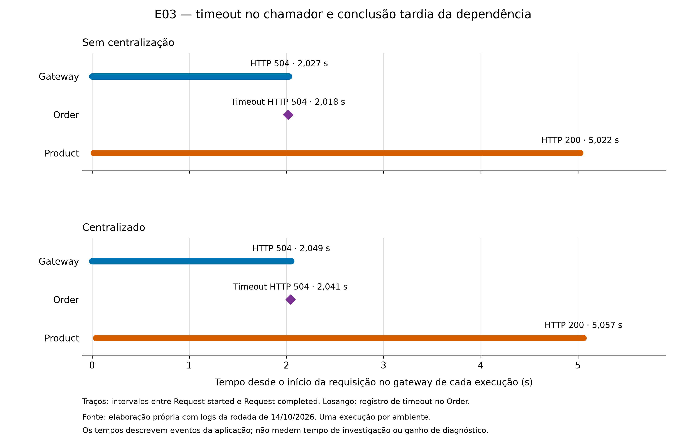
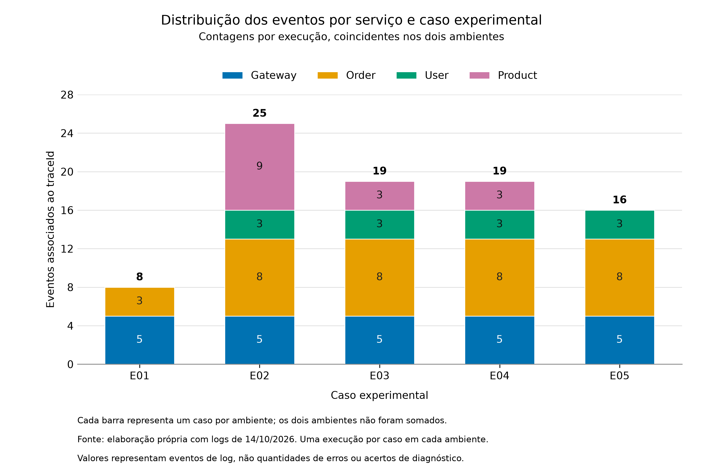

# 4 RESULTADOS E DISCUSSÃO

Esta seção apresenta os resultados da rodada de 14 de outubro de 2026, composta por cinco casos executados em cada um dos dois ambientes. A análise utiliza os metadados, as respostas HTTP e os logs preservados em coleta/rodada-01. Os resultados técnicos são diferenciados das interpretações retrospectivas das evidências, considerando os limites do delineamento apresentado na metodologia.

## 4.1 Caracterização das execuções e validação técnica

As dez execuções possuem indicação de sucesso nos metadados, com correspondência entre as respostas esperadas e observadas. As verificações de coleta de logs, restauração do ambiente e invariantes também foram concluídas com sucesso. Em todos os casos, o estoque registrado após a recuperação permaneceu igual a dez, e as listas de pedidos do usuário experimental permaneceram vazias.

A Tabela 1 apresenta as respostas esperadas e observadas na borda da aplicação. Os códigos identificam a classificação adotada pela implementação e permitem conferir o contrato técnico de cada cenário.

Tabela 1 — Respostas HTTP dos casos controlados nos dois ambientes

| Caso | Resposta esperada | Sem centralização | Centralizado |
|---|---|---|---|
| E01 | 400 / VALIDATION_ERROR | 400 / VALIDATION_ERROR | 400 / VALIDATION_ERROR |
| E02 | 502 / DOWNSTREAM_ERROR | 502 / DOWNSTREAM_ERROR | 502 / DOWNSTREAM_ERROR |
| E03 | 504 / DOWNSTREAM_TIMEOUT | 504 / DOWNSTREAM_TIMEOUT | 504 / DOWNSTREAM_TIMEOUT |
| E04 | 502 / DOWNSTREAM_ERROR | 502 / DOWNSTREAM_ERROR | 502 / DOWNSTREAM_ERROR |
| E05 | 502 / DOWNSTREAM_UNAVAILABLE | 502 / DOWNSTREAM_UNAVAILABLE | 502 / DOWNSTREAM_UNAVAILABLE |

Fonte: elaboração própria com os metadados e respostas da rodada de 14/10/2026.

A coincidência das respostas confirma o comportamento previsto para esses casos. Ela não representa uma taxa de acerto de investigadores, pois o executor verifica contratos e não interpreta a causa do erro. A distinção é especialmente relevante para E02 e E04, que apresentam o mesmo status e código externo, embora envolvam problemas internos diferentes.

Os relatórios complementares da rodada registram 16 testes Java sem falhas ou erros em cada ambiente, 14 testes do executor em cada variante e seis testes de observabilidade no centralizado. Os arquivos smoke.json apresentam 20 verificações por ambiente, com conferência de correlação habilitada. Essas evidências apoiam a validação da implementação e do procedimento de coleta; não ampliam o número de repetições experimentais utilizado na comparação.

## 4.2 Correspondência entre os erros provocados e os registros

### 4.2.1 E01 — Entrada inválida

No caso E01, a quantidade negativa resultou em HTTP 400 e código VALIDATION_ERROR nos dois ambientes. O order-service registrou a mensagem Request validation failed no nível WARN, acompanhada do detalhe items[0].quantity: must be greater than or equal to 1. Esse conteúdo situa o problema na validação da quantidade de um item do pedido.

Foram encontrados oito eventos do trace em cada ambiente, distribuídos entre gateway e order-service. A ausência de participação de user-service e product-service é compatível com a rejeição da entrada antes das consultas às dependências. A comparação não indicou uma nova evidência de categoria ou localização disponível exclusivamente no ambiente centralizado.

O caso também mostra que a análise não pode se limitar a mensagens ERROR. A evidência decisiva de validação foi registrada como WARN, enquanto o comportamento do sistema correspondeu à rejeição prevista de uma entrada inválida.

### 4.2.2 E02 — Indisponibilidade do banco de produtos

No caso E02, a interrupção do products-db foi seguida por HTTP 502 e código DOWNSTREAM_ERROR na resposta externa dos dois ambientes. Os registros do product-service incluíram falhas de conexão e de operação de banco, com SQLSTATE 57P01 e a mensagem FATAL: terminating connection due to administrator command. Também foi registrada a mensagem Database operation failed, com código DATABASE_UNAVAILABLE e status 503.

O order-service registrou que o product-service retornou HTTP 503 e apresentou a falha remota como HTTP 502. Os eventos do gateway documentaram o encaminhamento dessa resposta ao cliente. A associação pelo traceId permitiu examinar a cadeia entre a dependência de persistência do Product, o processamento do pedido e o resultado externo.

Foram encontrados 25 eventos em cada ambiente, distribuídos entre os quatro processos de aplicação. As mensagens internas forneceram evidências para localizar a categoria do problema na dependência de banco do Product. A identificação da interrupção deliberada do contêiner foi sustentada adicionalmente pelos metadados do procedimento, e não apenas pela interpretação de um status HTTP.

O par de execuções apresentou evidências correspondentes para essa interpretação. No centralizado, os metadados registraram a verificação dos campos dos 25 eventos no Loki. Essa conferência confirmou sua disponibilização na infraestrutura centralizada para o trace examinado.

### 4.2.3 E03 — Atraso de resposta e timeout

No caso E03, os dois ambientes retornaram HTTP 504 e código DOWNSTREAM_TIMEOUT. O order-service registrou uma HttpTimeoutException e a mensagem Timeout calling product-service, identificando a dependência cuja resposta não foi obtida dentro do prazo de espera.

Os registros do product-service mostraram que a consulta continuou e terminou com HTTP 200 após o timeout do chamador. A duração registrada pelo Product foi de 5.006 ms no ambiente sem centralização e 5.015 ms no centralizado. O encerramento da requisição no gateway ocorreu após aproximadamente dois segundos em ambos. Esses valores descrevem o comportamento das execuções observadas e são compatíveis com o atraso controlado de cinco segundos e o limite de leitura de dois segundos do Order.

A Figura 1 apresenta os instantes desses registros, tomando o início da requisição no gateway de cada execução como origem do tempo. Os segmentos representam os intervalos de atendimento do Gateway e do Product, enquanto o losango indica o registro de timeout no Order.

Figura 1 — Sequência temporal do caso E03 nos dois ambientes

Fonte: elaboração própria com os eventos associados ao traceId de E03 nos logs de 14/10/2026. Uma execução por ambiente; tempos relativos ao início de cada requisição.

A sequência apresentada na Figura 1 evidencia que uma operação remota pode concluir com sucesso depois de o chamador já ter encerrado sua espera. Considerar somente o HTTP 200 do Product ocultaria o impacto do atraso sobre o pedido; considerar somente o HTTP 504 externo não mostraria a conclusão tardia. A interpretação decorreu da associação dos eventos, operações e horários da mesma requisição.

Foram encontrados 19 eventos por ambiente, com participação dos quatro serviços, e os metadados centralizados registraram a verificação dos 19 eventos no Loki. O mesmo padrão de timeout seguido de conclusão tardia apareceu nos registros das duas configurações. As pequenas diferenças de duração não constituem evidência de melhora de diagnóstico e não foram tratadas como comparação estatística de desempenho.

### 4.2.4 E04 — Erro interno no serviço de produtos

No caso E04, o product-service registrou uma IllegalStateException com a mensagem Resource processing failed. O tratamento da exceção produziu o registro Unexpected processing error, acompanhado do código INTERNAL_ERROR e do status 500. O order-service registrou o retorno HTTP 500 da dependência e o apresentou externamente como HTTP 502, com código DOWNSTREAM_ERROR.

Foram encontrados 19 eventos em cada ambiente, distribuídos entre os quatro serviços. As mensagens e a exceção forneceram evidências de um erro interno de processamento no Product. Os metadados documentaram que a condição havia sido provocada pelo mecanismo controlado de exceção.

O contraste entre E02 e E04 é relevante porque os dois casos resultaram em HTTP 502 e DOWNSTREAM_ERROR na borda. Em E02, as mensagens internas relacionaram o problema ao acesso ao banco; em E04, registraram uma exceção de processamento. A distinção foi possível nos registros dos dois ambientes, mostrando o valor do contexto interno em relação à observação isolada da resposta externa.

### 4.2.5 E05 — Indisponibilidade do serviço de produtos

No caso E05, a interrupção do product-service resultou em HTTP 502 e código DOWNSTREAM_UNAVAILABLE nas duas configurações. O order-service registrou a mensagem Could not connect to product-service, indicando a dependência que não pôde ser acessada.

A manifestação da comunicação não foi idêntica entre as execuções. No ambiente sem centralização, o registro incluiu HttpConnectTimeoutException: HTTP connect timed out. No centralizado, foi registrada uma ConnectException, com causa UnresolvedAddressException. As duas manifestações foram classificadas pela implementação como indisponibilidade de comunicação com o Product.

Foram encontrados 16 eventos por ambiente, produzidos por gateway, order-service e user-service. A ausência de eventos de atendimento no Product é compatível com a parada do serviço e não foi interpretada como perda de registros pelo coletor. No centralizado, os metadados registraram a verificação dos 16 eventos no Loki.

Os logs permitiram reconhecer que o Product estava inacessível ao Order. Isoladamente, essa evidência não comprova que houve uma parada deliberada do contêiner, pois problemas de comunicação podem ter diferentes origens. O mecanismo exato aplicado ao caso foi conhecido pelos metadados do executor. A variação das exceções também impede atribuir eventuais diferenças de duração da requisição à centralização dos logs.

## 4.3 Preservação e disponibilização dos eventos no Loki

A seleção por traceId resultou em 87 eventos nos arquivos de origem de cada ambiente. As contagens por caso coincidiram entre as configurações: oito em E01, 25 em E02, 19 em E03, 19 em E04 e 16 em E05. A Tabela 2 relaciona essas contagens à conferência histórica registrada no ambiente centralizado.

Tabela 2 — Eventos das requisições experimentais e verificação no Loki

| Caso | Eventos sem centralização | Eventos centralizados na origem | Eventos de origem verificados no Loki |
|---|---:|---:|---:|
| E01 | 8 | 8 | 8 |
| E02 | 25 | 25 | 25 |
| E03 | 19 | 19 | 19 |
| E04 | 19 | 19 | 19 |
| E05 | 16 | 16 | 16 |
| Total | 87 | 87 | 87 |

Fonte: elaboração própria com os logs e os campos observability dos metadados de 14/10/2026.

A Figura 2 detalha a distribuição dos eventos entre os serviços. Como as contagens por serviço coincidiram nos dois ambientes, cada barra representa a contagem de uma execução do respectivo caso, válida para ambas as configurações. Os eventos dos dois ambientes não foram somados.

Figura 2 — Distribuição dos eventos por serviço e caso experimental

Fonte: elaboração própria com os eventos selecionados pelo traceId de cada execução nos logs de 14/10/2026. Uma execução por caso em cada ambiente.

Em E01, os registros se concentraram no Gateway e no Order, pois a validação interrompeu o fluxo antes das chamadas ao User e ao Product. Em E05, o Product estava parado e não produziu registros de atendimento da requisição. E02 apresentou a maior quantidade de eventos, incluindo nove do Product, no contexto da falha de acesso ao banco. A distribuição mostra onde os registros foram produzidos; seus valores não representam quantidades de erros nem acertos de diagnóstico.

Nos cinco metadados centralizados, a verificação possui indicação de sucesso, e os valores de events e sourceEventsVerified coincidem com as contagens dos respectivos traces nos arquivos locais. Conforme a implementação do verificador, esse resultado indica que os serviços participantes foram encontrados e que os valores dos campos de cada evento de origem possuíam correspondência nos resultados consultados no Loki.

O alcance dessa evidência é delimitado. A comparação cobre os eventos das cinco requisições, dentro dos intervalos temporais selecionados, e não todos os registros produzidos durante a execução da infraestrutura. O algoritmo procura correspondências para os campos originais, admitindo informações adicionais de transporte; ele não constitui uma demonstração geral de entrega exatamente uma vez ou de ausência de perdas sob qualquer volume de operação.

As cópias locais dos dois ambientes foram obtidas pelo mesmo procedimento de Docker Compose. Portanto, a semelhança de formato entre os arquivos não indica ausência de centralização. No ambiente centralized, houve também a coleta pelo Fluent Bit e a consulta de verificação ao Loki. A evidência preservada dessa consulta é o resumo nos metadados, acompanhado da rotina que realizou a comparação, e não uma exportação integral do Loki ou um histórico de uso humano do Grafana.

## 4.4 Comparação entre os ambientes e relação com a literatura

Nos cinco pares de casos, os registros das duas configurações apresentaram evidências para reconhecer as categorias de erro examinadas e os componentes envolvidos, observados os limites de especificidade de cada ocorrência. Não foi identificado um caso cuja categoria pudesse ser interpretada exclusivamente a partir dos registros do ambiente centralizado. Esse resultado corresponde à análise retrospectiva informada pelas condições experimentais e não a uma taxa de acerto de participantes.

A centralização acrescentou uma infraestrutura comum de armazenamento e consulta e preservou os eventos submetidos à verificação. A distinção entre esse resultado e a qualidade do diagnóstico é coerente com a organização proposta por Cândido, Aniche e van Deursen (2021): a infraestrutura viabiliza o acesso e o processamento dos registros, enquanto sua análise depende do conteúdo e da atividade de interpretação. No experimento, JSON e traceId já estavam presentes nas duas variantes, de modo que sua existência não pode ser atribuída exclusivamente ao Loki ou ao Grafana.

A discussão sobre injeção de falhas do mesmo mapeamento também ajuda a interpretar o confronto entre condição provocada e manifestação registrada. Nos casos analisados, houve mensagens e exceções relacionadas às categorias introduzidas. Essa correspondência descreve a capacidade das fontes de representar os acontecimentos escolhidos para o estudo; não implica cobertura de qualquer erro que possa ocorrer na aplicação.

Os resultados possuem um recorte diferente do monitoramento por métricas de Silva Neto (2023) e da integração entre métricas e rastreamentos de Chaves (2025). Esses trabalhos investigam informações e mecanismos de análise que não foram avaliados como variáveis neste experimento. A presença de resultados de detecção em outras aplicações não autoriza transferir suas taxas ou conclusões quantitativas para a comparação aqui realizada.

Sousa (2024) discute a instrumentação e a integração de ferramentas de observabilidade, oferecendo contexto para a infraestrutura implementada. Nesta pesquisa, a contribuição funcional demonstrada foi a disponibilização centralizada de registros correlacionáveis, com conferência de preservação nos casos estudados. Sua influência sobre a rapidez ou precisão de uma investigação humana não foi estabelecida pelo corpus.

O acesso local também permite filtrar arquivos pelo identificador e combinar saídas de múltiplos serviços. Consequentemente, a presença de quatro serviços não representa, por si só, quatro ações manuais nem uma quantidade mensurável de esforço. Como não há registros de interação de investigadores, a comparação não foi convertida em percentual de redução de trabalho ou tempo de diagnóstico.

## 4.5 Limitações e ameaças à validade

O conjunto contém uma execução de cada caso em cada ambiente. Essa configuração permite examinar os acontecimentos preservados, mas não estimar sua variabilidade nem demonstrar diferenças estatisticamente significativas. Os eventos de log e os testes automatizados não foram contabilizados como repetições independentes dos experimentos.

A aplicação possui um domínio simples e foi executada em ambiente local conteinerizado. O estudo não avaliou carga elevada, múltiplos hospedeiros, grande número de serviços ou diferentes condições de concorrência. As conclusões não foram generalizadas para todas as aplicações de produção ou para qualquer volume de dados.

A interpretação foi realizada retrospectivamente e com conhecimento das condições provocadas. Esse conhecimento pode orientar a procura pelas evidências e restringe afirmações sobre diagnóstico independente. Além disso, não foram preservadas medidas de precisão, esforço ou tempo de investigação humana, impossibilitando quantificar esses aspectos.

O arquivo paridade.log registra a comparação de 55 arquivos compartilhados de aplicação, build e experimentos. Os metadados apresentam contratos e parâmetros correspondentes, mas os identificadores das imagens de aplicação diferem entre os ambientes. A diferença de hashes não comprova uma diferença no código de negócio; a paridade de arquivos, por sua vez, não demonstra igualdade binária das imagens nem documenta um mesmo commit como origem de todos os artefatos. Esses elementos sustentam uma comparação delimitada, sem comprovar controle perfeito de todas as condições de execução.

A análise dos eventos centralizados utiliza cópias dos logs de origem e resumos históricos das verificações no Loki. A ausência do retorno bruto completo dessas consultas restringe a possibilidade de reexaminar diretamente todos os detalhes do resultado centralizado somente pelo corpus arquivado. Da mesma forma, a verificação de disponibilidade do Grafana não equivale à documentação de uma investigação realizada em sua interface.

A resposta à pergunta de pesquisa deve considerar esses limites. A infraestrutura reuniu e disponibilizou os registros examinados, preservando os campos conferidos no Loki. Entretanto, os dados coletados não estabeleceram melhora na precisão ou redução do tempo de diagnóstico, e a presença de evidências nos dois ambientes não constitui uma prova estatística de equivalência entre eles.
